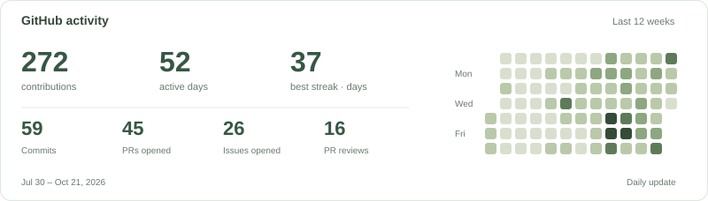

<figure>
  
</figure>

# Hi, I'm Zhigang.

**[Apache Kyuubi Committer](https://kyuubi.apache.org/project_history.html) · Data systems at Alibaba Cloud**

I work on data infrastructure and contribute to Apache Kyuubi and Apache Paimon. I'm exploring Ray Data, with a focus on distributed execution and performance for AI workloads.

### Open source

- **[Apache Kyuubi](https://github.com/apache/kyuubi)** · Committer. [My contributions](https://github.com/apache/kyuubi/pulls?q=is%3Apr+author%3Awangzhigang1999).
- **[Apache Paimon](https://github.com/apache/paimon)** · Contributor working on Python read paths and data correctness. [My contributions](https://github.com/apache/paimon/pulls?q=is%3Apr+author%3Awangzhigang1999).

<a href="https://github.com/wangzhigang1999/glance">
  <picture>
    <source media="(max-width: 600px)" srcset="assets/github-mobile.svg" />
    
  </picture>
</a>

### Things I build

- **[Glance](https://github.com/wangzhigang1999/glance)** — A little window into your digital life — GitHub activity and your connected home, right on your desk.
- **[CouchPilot](https://github.com/wangzhigang1999/couchpilot)** — Vibe code from the couch. Drive your AI coding workflow with a gamepad.

### Around here

Lakehouses · Query engines · Developer tools · Embedded Rust

[Repositories](https://github.com/wangzhigang1999?tab=repositories) · [Pull requests](https://github.com/pulls?q=is%3Apr+author%3Awangzhigang1999+is%3Apublic) · [A small meme project](https://github.com/wangzhigang1999/)
